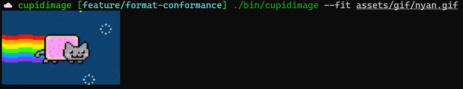

# cupidimage

cupidimage is a C99 image-decoding library and terminal preview tool. The library
has no external image-codec dependencies and produces RGBA pixels. The CLI renders
those pixels using ANSI truecolor, Kitty graphics, or Sixel.

It reads PNG, JPEG, WebP, GIF, BMP, ICO/CUR, TIFF, TGA, SVG, and PDF. Support varies
by feature: SVG and PDF are still partial renderers, WebP animation is not yet
implemented, and color-managed output is incomplete. See the
[format guide](docs/formats.md) and [conformance tracker](docs/format-conformance.md)
for the exact boundaries. HEIC/HEIF is deferred.

PDF previews include packed, indexed and fax-compressed images, inline images,
image masks, filter chains, opacity and RGB blending. Text supports matrices,
spacing, clipping, Type 3 glyph programs, variable-length encoding CMaps, CID
metrics, standard-font substitutes, and unhinted embedded TrueType, CFF and Type 1 outlines. Tiling/shading patterns and styled dashed strokes
are also supported, along with non-knockout RGB transparency groups. Full font fidelity,
general transparency groups,
mesh shadings and annotations still need work. See the [font guide](docs/pdf-fonts.md)
for the current boundaries; decoding a page does not mean it is drawn correctly.

## GIF rendering preview



Animated preview of the GIF renderer.

## Build and preview

```sh
make -j2
./bin/cupidimage --fit assets/png/basic.png
./bin/cupidimage --ansi assets/jpeg/cat.jpeg 120 60
./bin/cupidimage --pdf-page 2 assets/pdf/pdfjs/basicapi.pdf
./bin/cupidimage --sixel assets/webp/reference/quadrants.webp
```

The build produces `bin/libcupidimage.a` and `bin/cupidimage`. The library needs a
C99 compiler and the C/math libraries. The current CLI uses POSIX terminal APIs;
it is not a native Windows CLI build. See [building](docs/building.md) for library
installation and separate sanitizer builds.

The CLI tries Sixel, then Kitty, then ANSI when detecting terminal capabilities.
`--ansi` forces text-cell output. GIF animation plays in an interactive terminal;
redirected output uses its first composed frame. PDF output includes all pages
unless `--pdf-page` selects one. [CLI reference](docs/cli.md).

## Use the library

```c
#include "cupidimage.h"

int main(int argc, char **argv) {
    if (argc != 2) return 1;
    cupidimage_image image = {0};
    char error[256] = {0};
    if (!cupidimage_load_image_file(argv[1], &image, error, sizeof(error))) {
        fprintf(stderr, "%s\n", error);
        return 1;
    }
    int ok = cupidimage_render_ansi(&image, stdout, 120, 60);
    cupidimage_free(&image);
    return ok ? 0 : 1;
}
```

```sh
cc -Isrc examples/preview.c bin/libcupidimage.a -lm -o bin/preview
./bin/preview assets/png/basic.png
```

The [API guide](docs/api.md) covers ownership, pages, animation, SVG options,
terminal controls, and errors. The public declarations are in
[`src/cupidimage.h`](src/cupidimage.h).

## Test

```sh
make -j2 all test
make test-pdf-corpus
```

The normal suite checks every committed image asset, exposed page/frame, and
terminal output sample. It distinguishes reference-pixel matches from images
that merely decode. Deliberately malformed fixtures have explicit expectations.
CI runs GCC and Clang sanitizers and saves the asset reports.

For a broader PDF audit, an opt-in runner downloads all 1,007 tracked PDFs from a
pinned PDF.js revision. It has timeouts, resource limits, resumable reports, and
optional independent page comparisons:

```sh
make audit-pdf-full
```

Read the [testing guide](docs/testing.md) before starting that larger run. It
explains the external `.link` fixtures, comparison limits, and report statuses.
Downloaded corpora and generated reports stay outside Git.

## Documentation

- [Documentation index](docs/README.md)
- [Build and installation](docs/building.md)
- [Command-line reference](docs/cli.md)
- [Library API](docs/api.md)
- [Source architecture](docs/architecture.md)
- [Formats and known limitations](docs/formats.md)
- [Testing and full-corpus audits](docs/testing.md)
- [Interactive visual review and ratings](docs/visual-review.md)
- [Asset provenance](docs/test-assets.md)
- [Security and troubleshooting](docs/troubleshooting.md)

The project license is in [LICENSE](LICENSE). Some test assets have separate
licenses, retained beside the files and described in the asset guide.

Third-party data notices are in [THIRD_PARTY_NOTICES.md](THIRD_PARTY_NOTICES.md).
